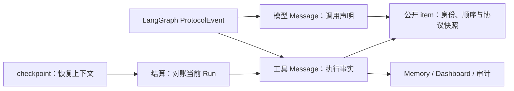

# Agent 输入队列与调度

本页解释 Public Thread 中的持久输入、优先队列、steer、控制输入和失败恢复。接口字段与示例见 [Agents Public API](../advanced/agents-public-api.md)。

## 范围与事实

队列按用户、APP、Agent 和 Thread 隔离。Thread 保存长期对话和独立的 `queue_paused`；每次提交对应一个稳定 Input，永久保存有序 `messages` JSON、提交级 `attachment_file_ids`、接收序号、调度类型、冻结配置和消费归属；Receipt 固定保存消息或控制事件的幂等键、意图及命令目标。Turn 保存一轮工作的状态，Run 保存执行段、owner、lease 和结果。PostgreSQL 拥有这些业务事实，Redis 负责 ARQ 投递、短期事件和取消加速。

```text
Thread A：Turn U / Run U1 运行中；队列：[Input S1][Input S2][Input F1][Input F2]
          S1/S2 独立接收和取消，消费时合批；F1/F2 各自 FIFO 执行
Thread B：独立领取自己的优先队头
```

接收事务依次校验完整作用域、锁定 Thread、重读 Receipt、验证 Turn 状态，并保存 Receipt、Input 和提交级附件绑定。接收不创建 Message。队列按数据库接收序号排序，不使用浏览器时间。相同幂等键和意图返回原回执及 Input ID；同键改变事件类型、模式、内容或附件列表返回 `409`。提交、转引导和取消输入的回执只指向 Input，执行归属从 Input 查询；消费不修改 Receipt。HTTP request ID 不参与生命周期。

Message 是消费后的执行投影：`source_input_id + input_position` 唯一标识原始消息位置，`received_at` 保留接收时间，`created_at` 表示进入执行投影的时间。消费事务生成 Message，再把每个 Input 的全部附件绑定到该 Input 最后一条用户 Message；正文、逐消息元信息和提交级附件引用继续保留。附件复合外键保证消息来自同一 Input。取消的未消费输入没有 Message。正式历史、搜索和模型记忆只读取执行消息；队列预览读取 Input 原文。已消费证明输入进入执行记录，模型实际读取内容由调用审计证明。

## follow-up 与 steer

两种提交均形成独立持久 Input。`follow_up` 按接收顺序逐条 FIFO 领取；`steer` 优先于 follow-up，同类按原接收序号排序，领取连续附件就绪前缀，遇到未就绪输入立即停止。合批只发生在消费事务中，后到的输入留给下一次消费，不额外等待聚合时间。

两类 pending Input 都不绑定 Turn。线程没有活跃 Turn 且队列未暂停时，调度器选择就绪优先队头，在同一 Session 锁和事务内创建 Turn 与首个 pending Run，按 Input 接收序号、消息位置创建 Message，并固定 Input 与附件的消费归属。任一步失败整体回滚；提交后才投递 ARQ。多个 Input 的 `consumed_run_id` 可指向同一 Run，Run 的有序 `input_ids` 由该关系派生。steer 在途期间旧 Turn 已结束时，仍以优先输入开启下一轮。

普通消息的 `mode` 表达优先级和切入时机，发送方不指定目标 Turn，HTTP/SSE 接收回执不返回有效模式。未指定 mode 时，在 Thread 锁内按运行中 steer、空闲 follow-up 选择；幂等重试先读取原 Receipt，不重新入队。等待用户回答、审批或取消清理时拒绝普通消息；协作等待时默认为 follow-up，只进入 FIFO 队列。

每个 Input 在接收时复制会话的完整可配置 Context，随消息原子应用单次模型与审批覆盖，领取时不重新读取 Agent 定义或系统默认值。会话更新只影响之后接收的输入，运行身份与授权在执行边界重新取得。空闲合批使用批次首个 Input 的冻结配置和执行来源，同 Turn 安全接管继承当前 Run 配置；批次其余 Input 的配置和来源保留审计，不在同一 Run 中切换。

当前模型调用和并行工具批次完成后，工具结果及 PostgreSQL checkpoint 先保存；`SteerMiddleware` 在下一次模型调用前，或无工具轮次的模型调用结束后，触发安全接管。旧 Run `yielded`，同一 Turn 创建下一 Run。首次模型调用前的让位允许 yielded Run 没有 AI 输出；真正 completed 的 Run 仍要求自身输出。没有 steer 的普通工具循环保持同一 Run。正在执行的外部工具不因 steer 被强制停止或撤销。

## 等待与控制

人工问题或审批使当前 Run `interrupted`、Turn `waiting`，等待点保存绑定的 Run、问题或工具调用 ID。等待期间已有 follow-up 保留，新普通消息被拒绝。客户端提交带 `turn_id`、`waitpoint_id` 和完整结构化回答或审批的恢复事件后，等待点只消费一次，并在同一 Turn 创建下一 Run。旧等待点不能恢复已经切换或取消的工作。

`yuxi.session.input.promote` 使用 `input_id` 和 `Idempotency-Key` 将 pending follow-up 原地转为 steer，保留 ID、正文、附件及接收顺序。同命令重试返回原 Receipt；新的命令遇到仍 pending 的 steer 视为已满足，不重复调度。已消费或取消、附件未就绪、等待回答/审批/协作、取消清理期间返回 `409`。空闲时可优先开启下一轮，队列暂停时可调整优先级但不解除暂停。

`cancel_input` 仅取消选中的 pending Input，保留正文及附件归属，不生成 Message，也不释放附件供其他输入复用。取消最后一条待办时清除空队列的暂停标记。若模型前已让位但事务内已无就绪引导，原 Run 保持 running，由同一 owner 从 checkpoint 继续，不重放原始输入或已完成工具；模型后已完成的轮次不额外调用模型。

取消 Turn 先设置 `cancelling`，有 pending Input 时暂停队列并保留输入；空队列不设置暂停。worker 确认当前 Run 已停止、必要资源清理完成后直接结束 Turn，人工等待取消则先清理 checkpoint。正常结束不等待周期扫描；进程失联或清理失败由恢复扫描补偿。`continue` 只在当前 Turn 已结束时解除暂停并领取优先队头，不复活取消的 Turn。未指定目标的取消在 owning transaction 中固定当前 Turn，重复取消返回原目标；已切换 Run 时可用 `expected_run_id` 拒绝陈旧操作。

等待取消通过原图的状态 API 清理 checkpoint：先合入已完成节点的 pending writes 并清除等待任务，再为当前 AI 的未完成调用补齐取消 ToolMessage，最后清除状态改写触发的待办节点。已完成工具结果与业务增量保留；当前 AI 之后的工具结果拥有完成事实，历史重复 call ID 不影响本批次。Thread/Turn 锁覆盖状态复查、资源与 checkpoint 清理和终态提交，使重复清理与下一轮领取串行。清理不执行模型或工具，进程在任一持久改写后失联时可幂等重试；失败仍保留 `cancelling` 由恢复扫描处理。

## 状态与故障恢复

| 对象 | 状态 | 业务含义 |
| --- | --- | --- |
| Input | `pending`、`consumed`、`cancelled` | 只表达投递，不跟随工作执行重复转态 |
| Turn | `running`、`waiting`、`cancelling`、`completed`、`failed`、`cancelled` | 一轮工作的当前段、等待点和明确结果 |
| Run | `pending`、`running`、`cancel_requested`、`completed`、`failed`、`cancelled`、`interrupted`、`yielded` | 一段执行及其 owner、lease 和结束原因 |

正常输出、Run 结束和 Turn 最终结果在 PostgreSQL 中按明确关联收敛；`output_message_id` 只指向同 Run 的 assistant Message，Turn `result_run_id` 只指向同 Turn 的顶层 Run。Run `yielded` 或 `interrupted` 不是 Turn 完成。失败、最终超时和取消仅暂停已有待办。用户显式继续时领取原优先队头；用户提交新的公开消息时，接收事务持久保存恢复意图并解除目标队列暂停，调度器优先单独消费最新恢复消息。该消息的附件未就绪时保留优先位置，旧 steer 不与它合批。新轮成功后恢复旧队列，再次失败或取消则暂停剩余待办；幂等重放、协作与定时输入不触发自动恢复。前轮必要清理未完成时，调度器不创建下一轮。

附件 Input 先持久接收来源，再准备 Workdir 文件并提交就绪事实。队头未就绪时不创建 Turn/Run，也不跳过它；pending steer 未就绪时不能安全接管。恢复扫描补全同一文件，取消只停止执行，仍完成已接收的文件提交；会话归档或 Project 软删除后准备恢复也继续，执行领取仍拒绝归档会话。准备失败与状态通过 Input/queue 的 `attachment_status`、`attachment_error` 回读，详细文件规则见[公开 API](../advanced/agents-public-api.md#图片与文件附件)。

ARQ 投递只发生在 owning transaction 提交后。持久 `pending` Run 可由恢复扫描补投同一个 Run；已经失败的工作不会自动创建新业务 Run。Worker 取得 Run 时记录唯一 attempt token、heartbeat 和 lease；过期的 `running` 或 `cancel_requested` 会收敛为可观察的 `worker_lease_expired` 失败。该失败只说明执行 ownership 丢失，外部工具副作用仍需核对。

`YUXI_JOB_TIMEOUT_SECONDS` 拥有单次 Agent 执行的业务时限，默认 3600 秒。到期后 runner 关闭执行流并持久化 `failed / execution_timeout`，ARQ 在外层额外保留 30 秒用于清理与提交。worker 退出继续使用 lease 释放与恢复路径。模型网络重试预算和工具局部超时由各自 runtime 拥有。

Thread SSE 把输入接收、Input 消费、Run 结束、Turn 结束和短期增量分开通知。断线时按 `Last-Event-ID` 续订，并重读 Input、Turn、Run 和历史的持久事实；Redis 的短期事件不是业务终态。

## 事务与消息归属

接收、配置治理、交互恢复和 checkpoint 结算各由所属 service 提交或回滚，仓储只查询、锁定或 flush。幂等指纹保留接收时的规范 JSON 字节；同命令同意图才重放，用户、APP、Thread 和键的唯一约束仍由 PG 拥有。锁前快速重放与锁后复查保留在各命令入口，权限和资源删除语义由所属用例决定。Run 创建在已有 Thread 锁内固定当前 Turn、冻结配置、Input 与恢复 Message；提交后通过 scheduler 投递同一个 Run。

[Message 仓储](https://github.com/xerrors/Yuxi/blob/main/backend/yuxi/modules/agents/repositories/messages.py)拥有正式消息的共同写入和读取，工具执行只保存在 `tool_audit` Message 中；Input 消费、模型/工具审计与公开 item 仓储分别拥有原始来源投影、执行事实与公开快照的原子更新。[checkpoint 消息结算](https://github.com/xerrors/Yuxi/blob/main/backend/yuxi/modules/agents/services/checkpoint_messages.py)显式接收 AsyncSession，在同一事务对账这些事实并结算 Run/Turn。完成路径在 Thread/Turn 锁后锁定并裁决待处理 steer，再取得 Run 锁；其他终态保留各自锁定位置。终态服务消费调用方在同一事务锁定的对象与 steer 就绪裁决，继续检查 current Run 与 lease。最终回答由 `result_run_id` 明确绑定。终态提交后释放运行清理责任，再发布公开事件；协作通知与业务状态在同一 PG 事务写入，观察与恢复可补读。[事件订阅](https://github.com/xerrors/Yuxi/blob/main/backend/yuxi/modules/agents/services/subscriptions.py)消费持久生命周期和 Redis 投影，[审计读取](https://github.com/xerrors/Yuxi/blob/main/backend/yuxi/modules/agents/services/message_audits.py)只组装已授权持久事实。

Memory 历史仓储负责用户与消息可见性查询，历史服务负责输入范围、预览、工具数量与 UTF-8 响应预算。重复默认定义和环境内容读取保持持久身份与修订时间，重复查看同一终态 Run 不再次提交。execution 主流程在进入模型流前提交 runtime、附件与追踪准备事务，禁用追踪时也经过此提交点；准备或提交失败会回滚、结束 observation 并进入失败收敛，图不执行。协作树和用户环境维护使用[运行锁键](https://github.com/xerrors/Yuxi/blob/main/backend/yuxi/modules/agents/runtime_locks.py)；行锁次序由消费、输出和恢复仓储拥有，Input 行锁先于 Run 终态更新。

## 工具声明与执行事实

模型 Message 的 `tool_calls` 保存调用声明，声明本身不代表工具已经执行。每个 Run 内的 `operation_id` 唯一标识一条工具执行 Message，后者拥有输入、结果、错误、起止时间与 `execution_status`。开始、完成、错误和 Run 终态只更新这一条事实；checkpoint 结算只对账当前 Run 已登记的模型与工具消息，缺少模型生命周期事实的最终输出会被拒绝。



审批拒绝生成没有执行开始时间的工具结果，并记录拒绝来源。恢复后的执行通过同 Session、同 Turn 的明确 resume 来源链关联模型声明。Memory 显式请求工具详情时，只读取已授权模型消息关联的同会话、同 Turn 工具事实；Dashboard 执行统计仅计已经开始的操作，失败、中断与运行中分别按真实状态读取。

公开 item 保留分页、断线恢复与公开范围所需的稳定身份及快照。执行事实先提交，公开投影随后提交并发布；投影失败不会改写已完成的工具事实，恢复可重放补齐同一 item。独立 ToolCall 表和同步结果副本不参与该链路。

## 权限、源码与验证

Public 身份在 HTTP 边界变为包含 `uid`、`app_id` 的作用域；接收、查询及副作用用例在 Thread 和相关记录上再次校验。归档 Thread 拒绝活跃 Turn 或待处理 Input，并保留历史。Project 删除在同一事务检查这些条件后归档所属 Thread，不修改 Workdir 字节。

入口位于 [Public Agent router](https://github.com/xerrors/Yuxi/tree/main/backend/yuxi/api/routers/public_v1/agents)，接收与优先调度分别由 [inputs](https://github.com/xerrors/Yuxi/blob/main/backend/yuxi/modules/agents/services/inputs.py) 和 [scheduler](https://github.com/xerrors/Yuxi/blob/main/backend/yuxi/modules/agents/services/scheduler.py) 拥有；[turns](https://github.com/xerrors/Yuxi/blob/main/backend/yuxi/modules/agents/services/turns.py)、[runs](https://github.com/xerrors/Yuxi/blob/main/backend/yuxi/modules/agents/services/runs.py) 与 [worker](https://github.com/xerrors/Yuxi/blob/main/backend/yuxi/workers/settings.py) 拥有控制和执行收敛。真实 PostgreSQL/HTTP 与 worker 测试位于 `backend/test/integration`、`backend/test/e2e`；验收需回读 Input、Turn、Run、消息、checkpoint 和产物，不能只以 `202` 或 SSE 结束判定成功。

## 独立委派

协作会话复用持久 Input、Receipt、优先领取、提交后投递和 lease 链路，各自 Turn 拥有 current_run_id、result_run_id 和等待点。普通取消只影响指定 Turn，父轮次完成、失败或取消均保留后代独立工作。新工作通过 submit_input 按 FIFO 接收，队列暂停时只排队；用户显式“停止全部”才取消整树在途 Turn 并阻止各队列消费。“继续整树队列”重新调度保留输入，已取消的 Turn 保持终态。整树在途工作与清理全部结束后，用户发送新消息可解除整树停止门禁，但只恢复目标会话并优先处理该消息；其他成员的旧待办保持暂停。协作等待保存目标、游标和截止时间，在同一 Turn 建立下一 Run，等待中的普通 follow-up 只排队，steer 明确拒绝。具体约束见[会话协作](../agents/session-cooperation.md)。
