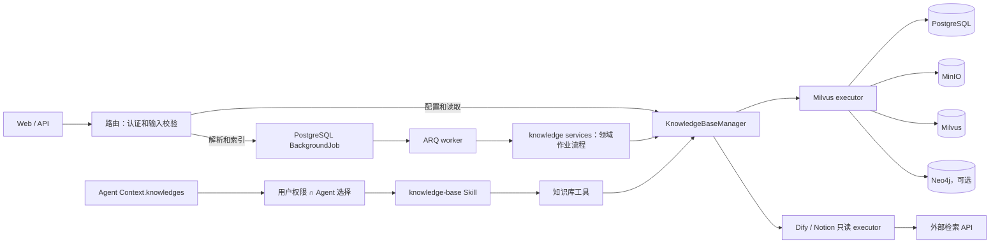
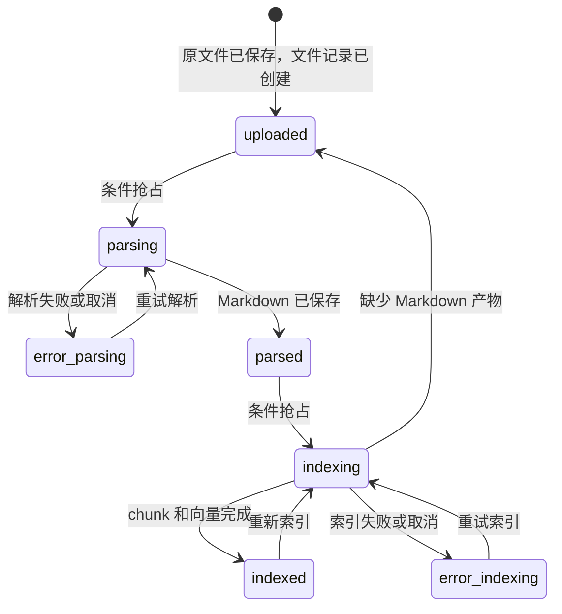

# 知识库机制

本页说明文档怎样从上传走到可检索状态，以及 PostgreSQL、MinIO、Milvus、Neo4j、后台作业 和 Agent 工具各自负责什么。第一次操作知识库请看[创建并使用知识库](../intro/knowledge-base.md)，解析器配置见[文档处理与 OCR](../advanced/document-processing.md)。

## 能力边界

Yuxi 通过 `KnowledgeBaseManager` 读取知识库配置、解析权限并选择 executor：

- `milvus` 是文档型知识库，支持上传、解析、分块、向量索引、预览和检索，也可以构建知识图谱；
- `dify` 和 `notion` 是只读连接器，只保存外部连接信息并执行 Query，不承载 Yuxi 的上传、解析、索引、文件树和全文预览。

前端按钮只反映 executor 的能力，最终判断由后端完成。只读连接器收到不支持的操作时会明确报错。

## 两条链路

管理链路改变知识库事实，Agent 链路消费当前用户和当前 Agent 可见的知识库：



管理路由对配置、列表和详情直接调用 Manager，对解析和索引登记后台作业；worker 根据 registry 调用知识库 service，再由 Manager 选择 executor。Manager 负责配置和 executor 选择；具体 executor 负责解析、索引和检索。知识库配置的最终值在 PostgreSQL，Redis 只缓存最小运行配置，未命中或异常时回源数据库。

未删除知识库的名称由 PostgreSQL 唯一索引约束，名称不区分大小写，已删除名称可复用。并发创建或重命名冲突返回 HTTP 409，冲突事务不改变已有记录。

## 存储装配与内部边界

`KnowledgeExecutor` 表示按知识库类型复用的执行器，`KnowledgeBase` ORM 表示 PostgreSQL 配置行。Manager 保留配置解析、类型选择、权限摘要和公开结果装配；文件移动、读取等转发入口负责取得当前类型执行器。`services/access.py` 拥有用户可见范围，路由与 Agent 工具共同消费该入口。

文档与图谱通过 `knowledge/storage/milvus.py` 装配中文正文、embedding、BM25 函数和索引。文档、实体和三元组各自保留已有列顺序及来源字段。新集合采用统一字段定义，已有集合不自动重建。Milvus 与 Neo4j 查询分别使用每事件循环 8 个线程的预算；调用方取消等待后，实际线程退出才归还容量。

Milvus 执行器持有 `KnowledgeGraphService`，首次图检索在线程内初始化图向量客户端，后续请求复用。Neo4j 连接由基础设施管理，图谱服务协调 PG 事实与 Neo4j/Milvus 投影。一次图谱构建复用一个抽取模型客户端；模型 JSON 归一化负责实体属性合并和关系去重，图 payload 转换只分配局部 ID。

分块入口和配置位于 `chunking/dispatcher.py` 与 `chunking/presets.py`。`ragflow_like` 是借鉴 RAGFlow 思路并经过本地修改的适配实现；其中 parser 使用 Yuxi 的 `source_spans` 保留原文定位，不能按未修改的第三方 vendor 整体替换。语义分块通过 `chunk_parser_config.embed_model_id` 接收模型 spec；索引用例在未指定时注入系统 embedding 配置。缺失模型或装配故障使索引失败，不产出普通切分结果。固定输入的分块和来源范围由 parser 测试拥有。

摄取 chunk 字典、PostgreSQL 行、Milvus 列数组与检索结果各自服务不同边界：dispatcher 生成内容与来源范围，Milvus 执行器明确转换为 PG 字段和向量列，检索再从 PG 补全当前可见文件来源。文件元数据、目录投影和 HTTP 列表保持各自需要的字段，不把虚拟目录当作持久化文件。运行时查询以 `MilvusRetrievalConfig` 为默认值，再叠加持久化选项和本次请求；面板使用同一默认配置。已有显式配置继续生效，未保存的阈值与 BM25 数量分别取 0.0 和 50。

知识库软删除由 `KnowledgeBaseRepository.mark_deleted` 在一个事务中写入 KB、文件 tombstone 和批量 outbox，清理任务完成外部删除后调用 `purge`。评估成功/失败钩子在后台任务的 owning transaction 中调用 repository 持久化，筛选和分页由 PostgreSQL 执行。

## 文档状态机

上传、解析和索引是三个可以分别观察的动作：



`file_status.py` 拥有当前写入状态和历史读取映射。目录写入 `done`；普通文件的历史 `done` 按 `indexed`、`failed` 按 `error_indexing` 筛选，文件列表与跨库搜索使用同一映射。`parsing` 和 `indexing` 表示当前动作已经抢到执行权；没有抢到允许状态的并发请求会失败，同一文件不会由两个动作同时推进。

- `uploaded`：原文件和文件记录存在，尚未完成解析；
- `parsed`：解析后的 Markdown 路径已写入文件记录；
- `indexed`：本次分块、向量写入和统计更新已完成；
- `error_parsing`、`error_indexing`：对应阶段失败或取消，并保存错误信息。

任务接口的响应和 后台作业 状态只表示编排结果。验收时重新读取文件状态，并按需核对 Markdown、chunk、向量和图谱数据。

## 各存储负责什么

| 存储 | 拥有的事实 | 不拥有的事实 |
| --- | --- | --- |
| PostgreSQL | 知识库配置、权限、文件元数据和状态、chunk 正文与原文行号、图谱处理状态、BackgroundJob 执行意图与 lease | 原文件字节、向量索引 |
| MinIO | 上传原件、解析 Markdown、解析图片 | 文件当前状态、用户权限 |
| Milvus | chunk 向量、BM25/混合检索字段、图实体和关系向量 | 权限、文件状态 |
| Neo4j | 可选的实体、关系和 chunk 关联 | 原文件、权限和检索排序 |
| Redis / ARQ | BackgroundJob 投递与 worker 唤醒、知识库最小运行配置缓存 | BackgroundJob 最终状态、配置最终值、文件状态 |

知识库解析先生成本地 Markdown 目录，再将图片和 Markdown 写入该文档本次解析的独占 MinIO 前缀。文件记录提交 `parsed` 与新 Markdown 路径后，服务回收旧尝试；失败或 owner 丢失只回收未发布的当前尝试，旧产物保持可读。取消发生在结果发布后的旧资源回收阶段时，已发布结果仍然有效。删除文档按文档前缀回收解析资源，其他文档的资源保留。

Milvus 索引会把 chunk 写入 PostgreSQL 和 Milvus。它不是跨存储事务：任一侧失败时会尝试补偿并把文件置为 `error_indexing`，排查时需要同时查看两侧。

分块时保存 `chunk_index`、`start_line` 和 `end_line`，行号以 MinIO 保存的完整解析文本为基准，从 1 开始且包含首尾行；空行也计数，Markdown 和 TXT 使用同一规则。切片、合并与重叠携带原始字符位置，生成的标题与问答前缀不作为原文行。HTML 表格转键值对后的片段保留原表格块范围，CSV 解码后的问答及其子块保留完整 record 范围。检索从当前 active generation 的 PostgreSQL chunk 补齐行号与文件名。当前知识域 Schema 持有这些行号列，部署前提见[部署参考](../advanced/deployment.md#3-数据库与文件目录)。

文件内容接口同时返回完整解析文本与片段范围，并以 `line_location` 标明能否定位：完整原文可读、文件快照已完成入库、chunk 与该快照的 active generation 相同才可用。原文缺失、入库尚未完成、片段读取失败或读取期间代次改变时，预览显示原因并禁用高亮；失效的检索结果需重新检索。

## 后台作业 和恢复

JobTracker 保存任务登记、执行方上报的进度与结果摘要，并提供管理员查询和取消请求。知识库和评估 service 拥有业务结论：文档导入遇到任一失败会结束为失败，批量解析或索引可以执行完成并报告失败计数。进度达到 100 不决定任务终态。后台作业只展示有限资源引用和计数，完整结果从业务资源读取。

上传原文件是同步对象存储操作；批量添加、解析、索引和图谱构建把 `job_type`、Handler 版本和可序列化 payload 保存到 PostgreSQL。提交后 API 只发布 `job_id`，ARQ worker 从 registry 加载领域 Handler。

提交端在事务完成后发布作业 ID；worker 从共享作业定义加载 Handler，拥有领取、执行、超时和失联检测，用唯一 attempt token claim 作业 并续租 lease；重复投递和失权 worker 的迟到写入会被 PostgreSQL 拒绝。首次发布失败时，pending 作业 保留，启动和周期 publisher 会补发。所有 后台作业 在 owner 中断或 lease 过期后都会明确失败，不自动重放未知外部副作用。领域 failure hook 由 worker 在终态事务中调用，JobTracker 的观察和取消入口不调用这些 Hook。

批量“待解析”和“待入库”入口按状态筛选文件，并通过数据库 dedupe key 拒绝活跃重复任务。取消任务时先保存 `cancel_requested`；pending 任务由 worker 确认无需执行，running 任务由领域 Handler 在安全检查点响应。确认前任务保持原状态，已经终态的记录拒绝迟到写入。重试前保留故障现场，检查文件记录、MinIO、chunk、Milvus 和 Neo4j，再选择重新解析、重新索引或图谱修复。

## Agent 如何看到知识库

`query_kb` 的检索异常由工具错误中间件转换为绑定当前调用的错误 ToolMessage，审计与公开结果保留失败状态，界面展示错误。正常检索没有命中时返回成功的空结果。错误中间件隐藏底层异常详情，工具失败后模型可以继续处理本轮任务。

知识库 service 按当前用户的读取权限查询资源，再与调用方的全部或显式选择求交集。Agent 准备阶段只保存归一化后的 `Context.knowledges` ID 列表；知识工具每次执行时重新解析当前权限与该列表的交集，配置列表不作为执行授权。Public API 使用同一 service，按本次请求的用户身份解析全部可读知识库。工具目标必须属于本次解析的范围，文档归属由知识库查询实现校验。撤销读取权限后，后续工具调用拒绝该资源；权限查询失败向调用边界传播，不返回空列表掩盖存储故障。授权查询与实际数据读取遵循各自事务边界。

知识库工具由内置 `knowledge-base` Skill 提供。模型读取该 Skill 的 `SKILL.md` 后，才会看到：

```text
list_kbs、query_kb、find_kb_document、open_kb_document、
search_file、download_kb_file
```

推荐顺序是：列出可见知识库 → 检索候选片段 → 用 `file_id` 打开或定位原文。`download_kb_file` 会把有权访问的原始二进制写入当前 Project 的 `outputs`，供后续工具处理。知识库不会映射为 `/home/gem/kbs` 沙盒目录。

## 权限

知识库的最终授权由后端依赖、Manager 可见性查询和具体工具目标校验共同完成：

- 读取、检索、打开和下载需要 read 权限；
- 创建、更新、添加文件、解析、索引、删除和图谱写操作需要 manage 权限；
- 原文件上传入口要求管理员，并在传入 `kb_id` 时继续检查该知识库的 manage 权限；
- 前端守卫、按钮隐藏、Agent 配置和提示词只控制呈现或缩小范围，不能授予权限。

Agent 的 `knowledges` 只能缩小用户已有权限。协作会话继承派发方的配置并沿用发起用户的身份，每次执行仍复查资源可见性。私有解析图片通过带知识库权限校验的 API 读取，MinIO 对象 URL 不是授权凭证。

## 失败和重试

- 解析失败或取消：文件进入 `error_parsing`，查看错误并重新提交解析；批量待解析入口只扫描 `uploaded`。
- 索引失败或取消：文件进入 `error_indexing`，检查分块、嵌入和存储后重新入库；批量待入库入口扫描 `parsed` 和 `error_indexing`。
- 索引缺少 Markdown：文件回到 `uploaded`，必须重新解析，不会生成空索引。
- 后台作业 失败、取消或 lease 过期：只能说明后台动作未完成，不能推断外部存储没有部分写入；知识任务不会在未知副作用上自动重放。失败收敛 hook 在同一 PostgreSQL 事务内更新仍由该 Job 拥有的文件错误态与知识库持久统计；已由其他 Job 接管的文件保留其当前状态。详情与文件列表的统计从 PostgreSQL 读取当前聚合，文件提交后的读取直接反映最新状态。
- Redis 缓存异常：Manager 回源 PostgreSQL；不支持的知识库类型或 executor 初始化失败会明确阻止操作。

## 源码定位与验证

按需要修改的用户流程选择入口：

| 维护任务 | 起点与职责 | 继续追踪 |
| --- | --- | --- |
| 管理配置、文件列表和检索调度 | [Manager](https://github.com/xerrors/Yuxi/blob/main/backend/yuxi/modules/knowledge/manager.py) 读取配置、查询可见性并选择 executor | repositories 拥有持久查询；base 与 implementations 拥有文件处理和具体存储操作 |
| 异步导入、解析、索引和图谱构建 | [知识库作业 service](https://github.com/xerrors/Yuxi/blob/main/backend/yuxi/modules/knowledge/services/background_jobs.py) 组织领域动作、进度和失败结论 | background_jobs registry/worker 拥有调度与 lease；文档处理由 Manager 分派，图谱构建直接调用 KnowledgeGraphService |
| Agent 或 Public API 的知识能力 | [访问 service](https://github.com/xerrors/Yuxi/blob/main/backend/yuxi/modules/knowledge/services/access.py) 计算当前权限与所选范围的交集；[工具 service](https://github.com/xerrors/Yuxi/blob/main/backend/yuxi/modules/knowledge/services/tools.py) 组织领域工具操作 | extensions 工具与 Public 路由适配调用，执行时复查可见性与文档归属 |

Agent Context 中的资源选项查询用于配置界面；执行权限仍由访问 service 与实际读取边界核验。增加用例时沿上述 Owner 修改，状态与持久化查询继续留在其负责的领域实现。

- [知识库路由](https://github.com/xerrors/Yuxi/blob/main/backend/yuxi/api/routers/knowledge/management.py)：权限、上传、任务和状态筛选
- [KnowledgeBaseManager](https://github.com/xerrors/Yuxi/blob/main/backend/yuxi/modules/knowledge/manager.py)：配置回源、可见性和 executor 调度
- [知识库基类](https://github.com/xerrors/Yuxi/blob/main/backend/yuxi/modules/knowledge/base.py)：文件状态和解析流程
- [Milvus executor](https://github.com/xerrors/Yuxi/blob/main/backend/yuxi/modules/knowledge/implementations/milvus.py)：分块、双写、检索和重索引
- [只读连接器](https://github.com/xerrors/Yuxi/blob/main/backend/yuxi/modules/knowledge/implementations/read_only_connectors.py)：Dify/Notion 能力边界
- [JobTracker](https://github.com/xerrors/Yuxi/blob/main/backend/yuxi/modules/background_jobs/service.py)：任务登记、进度观察与取消请求
- [后台作业 worker](https://github.com/xerrors/Yuxi/blob/main/backend/yuxi/workers/background_jobs.py)：Handler 执行、lease 与领域终态 Hook
- [作业 Handler registry](https://github.com/xerrors/Yuxi/blob/main/backend/yuxi/modules/background_jobs/registry.py)：领域 Handler 注册和惰性加载
- [知识库工具](https://github.com/xerrors/Yuxi/blob/main/backend/yuxi/modules/extensions/tools/knowledge/tools.py)：Agent 目标校验和工具实现
- [知识库 unit tests](https://github.com/xerrors/Yuxi/tree/main/backend/test/unit/knowledge)
- [权限与路由 tests](https://github.com/xerrors/Yuxi/tree/main/backend/test/unit/routers)
- [知识库 HTTP integration](https://github.com/xerrors/Yuxi/blob/main/backend/test/integration/api/test_knowledge_router.py)
- [Public 工具 integration](https://github.com/xerrors/Yuxi/blob/main/backend/test/integration/api/test_public_knowledge_tools.py)

修改状态、权限、存储或 Agent 工具链路时，至少运行对应 unit 和真实 HTTP integration；涉及外部存储时，从 PostgreSQL、MinIO、Milvus 或 Neo4j 回读最终结果。
