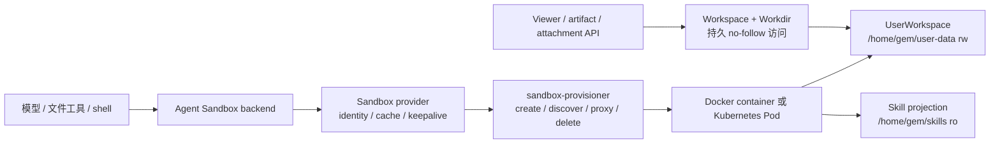

# 沙盒与文件系统机制

本页解释 Agent 的文件和命令如何进入动态沙盒，以及 UserWorkspace、Project Workdir、Skills、Viewer 和 provisioner 的关系。部署参数见[沙盒配置与运维](../advanced/sandbox-operations.md)。

## 一句话理解

Yuxi 让多个访问入口看到同一份持久文件，但给它们不同的访问能力：

- Agent 通过带认证的 provisioner 代理访问动态 Sandbox；
- Viewer、附件和 artifact API 直接访问 UserWorkspace 的持久文件；
- 知识库通过知识库工具访问，不挂载为沙盒目录。

模型和产品接口只使用虚拟路径。宿主机路径、容器路径和对象存储 URL 不能混用；每个文件入口都在所属文件系统边界内校验路径、用户和权限。

## 运行链路

Graph 创建时，Agent backend 取得 `uid`、根运行 scope 和 `workdir_path`。实际沙盒惰性创建；API/worker 只持有 provisioner 代理地址，不直接访问动态容器或 NodePort。

[`sandbox/backend.py`](https://github.com/xerrors/Yuxi/blob/main/backend/yuxi/modules/agents/runtime/sandbox/backend.py) 按已准备的 Context 装配 CompositeBackend，文件与摘要 middleware 共用构图创建的实例。装配要求显式提供 `runtime_scope_id` 和 `workdir_relative_path`，缺失值直接失败；runtime scope 不从 checkpoint thread 推断。产物根由持久化 Workdir 相对路径映射为 runtime 路径后追加 `outputs`，大工具结果与对话历史分别写入其 `large_tool_results` 和 `conversation_history` 子目录。装配取舍见[后端直接装配决定](../develop-guides/decisions/implemented/2026-09-30-sandbox-backend-assembly.md)。

## Identity、Workdir 和生命周期

`runtime_scope_id` 使用协作树根 Session 的 thread ID。同树各 Session 拥有独立历史、Turn、Run 和 checkpoint，但共享根 Session 的运行时、沙盒环境和 Project Workdir；沙盒内的 `/tmp`、后台进程也由整棵树共享。子 Session 可在派发方 Turn 结束后继续运行、等待和恢复；派发不继承聊天上下文，也不 fork checkpoint。

Session 通过 `project_id` 绑定 Project；Project 拥有这项绑定和 `workdir_path`，UserWorkspace 拥有该路径下的实际文件字节。`workdir_path` 是当前用户 UserWorkspace 下的合法相对 POSIX 路径，不能包含 `..`、反斜杠或符号链接。`linked` Project 只能引用已经存在的目录，目标不存在时请求失败。新 `managed` Project 使用上海时间和 Project ID 前 8 位分配 `projects/YYYY-MM-DD_HH-MM-SS_<project-id-prefix>`；同名条目已经存在时依次追加 `-1`、`-2`，既有 `projects/<uuid>` 保持有效，目录创建失败时请求失败。Workdir 决定当前工作目录和 Viewer 文件范围，但不决定 sandbox identity，也不把同一用户的其他 Project 变成安全隔离边界。两个顶层 Session 即使绑定同一 Workdir，也会创建不同 runtime。

| 运行类型 | checkpoint | runtime scope | Workdir |
| --- | --- | --- | --- |
| 根 Session | 当前 thread | 根 thread | 当前 Project 的 Workdir |
| 协作后代 Session | 当前 thread | 根 thread | 派发方继承的 Project Workdir |
| 远程 Skill 安装 | 临时 thread | 临时 thread | 无持久用户目录，`inherit_env=False` |

`uid + runtime_scope_id` 派生稳定 `sandbox_id`。同一 runtime 存活期间不能改绑到另一个 Workdir。协作 Run 收敛后释放自己的执行名额，不立即清理共享 runtime。整棵树没有非终态 Run，且持续空闲五分钟后，由 worker 回收共享沙盒并保留 UserWorkspace 文件；等待中的 Turn 或冻结队列里的 Input 不保证保留沙盒；回收会清空 `/tmp` 并结束后台进程。后续输入重新按同一根 runtime scope 创建沙盒。远程 Skill 安装和主动上下文压缩各使用独立的一次性 runtime，并由自身执行 Owner 清理。主动压缩挂载同一已授权 Workdir，保留原 Session 的 checkpoint 身份，不释放协作树的执行环境。

## 挂载和文件 Owner

| 虚拟路径 | 内容 | Agent 权限 |
| --- | --- | --- |
| `/home/gem/user-data` | 当前用户的整个 UserWorkspace | 读写 |
| `/home/gem/skills` | 当前用户已授权的共享/内置 Skill 投影 | 只读 |
| `/home/gem/user-data/<workdir_path>` | 当前 Project 的工作目录 | 默认 cwd |

`uploads/` 和 `outputs/` 在首次使用时创建。个人 Skill 位于 `/home/gem/user-data/agents/skills/<slug>`，不会复制到共享 projection。

同一用户的 Sandbox 能看到整个 UserWorkspace，所以 Project A 可以读取 Project B。系统提示词要求 Agent 未经用户明确要求不要在当前 Workdir 外写入，但这只是行为约束，不是安全隔离；真正的边界由用户挂载、Workdir ownership 查询和工具路径校验提供。

文件访问使用相对路径和 no-follow 原语，拒绝 `..`、符号链接、特殊文件和跨用户根目录。普通运行服务以 `1000:1000` 访问数据。

runtime 绝对路径由 `sandbox/paths.normalize_runtime_path` 校验，UserWorkspace 和 Workdir 浏览 scope 由 `workspace/paths.normalize_workspace_scope` 校验；两者分别拒绝跳转、URL、反斜杠和 NUL，通过显式映射连接。产物登记与读取共用 `normalize_artifact_path`，要求非空 Workdir 绑定和当前用户可见 runtime 根。子目录名共用单组件校验；宿主 no-follow 与远端文件脚本都将链接拒绝翻译为权限异常。目录 fd 原语保留 ELOOP 供调用方识别，普通文件边界将它映射为 PermissionError。

文件工具只从注入的 Context 读取 uid、runtime scope 和 Workdir，模型 state 与 configurable 不提供身份回退。Workspace 与 provisioner backend 分别提供宿主 scope 和 runtime 路径的操作；Workdir 的转发为每次操作附加已绑定根，Viewer 只能使用该受限视图，个人工作区使用 Workspace 的 uid 根。两套文件能力保留路径和返回类型差异，共用的条目字段与排序由 workspace service 维护。

Agent 的 `grep` 通过沙盒原生文件搜索 API 执行字面量匹配，未指定路径时搜索当前用户的 UserWorkspace 与已授权共享 Skill。结果包含路径、行号、文本和截断标志，并受跨根全局 `max_count` 限制；未指定限额时采用原生服务默认值（1.11.0 每根 500 条），达到限额会标记截断。默认搜索不包含隐藏文件，可通过显式 glob 选择；目录 glob 相对于搜索根。单根结构化结果超过 `SANDBOX_MAX_OUTPUT_BYTES` 时返回明确错误。

搜索请求路径必须属于可读根，glob 拒绝 `..`。原生搜索允许显式指定的根内符号链接指向容器内其他位置；grep 不提供容器内部的 no-follow 隔离。用户之间的隔离由 provisioner 的 uid、挂载与独立容器边界执行，Agent 的 shell 也使用同一容器边界。宿主 Workspace 文件访问继续执行上述 no-follow 契约。

## Docker 和 Kubernetes

Docker backend 为每个 runtime 创建独立 bridge 网络，不发布沙盒端口，也不加入应用 `app-network`。网络只连接 provisioner 和对应沙盒，因此沙盒不能互访，也不能直接访问 PostgreSQL、Redis、MinIO、Milvus 或 Neo4j。provisioner 复用实例前会检查 uid、Workdir、挂载和网络身份。

Kubernetes backend 创建 Pod 和 NodePort Service。Pod 从 User Data PVC 的 `shared/<uid>/workspace` 挂载 `/home/gem/user-data`，从 Skill PVC 的 `skill-projections/<uid>` 只读挂载 `/home/gem/skills`。Pod 默认不自动挂载 ServiceAccount token；具体安全性仍取决于 namespace、PVC、NetworkPolicy 和 ServiceAccount 配置。

`memory` backend 只记录 ID 到 URL 的映射，不创建隔离环境或准备持久目录，不能作为生产隔离承诺。

## 环境变量和信任边界

API/worker 使用 `SANDBOX_PROVISIONER_TOKEN` 调用 provisioner。动态沙盒的同步创建调用 AgentEnvRepository 同步读取 PostgreSQL 的用户配置，异步 API 仓储使用同一行；SQLAlchemy 驱动前缀由 PostgreSQL 基础设施转换，查询字符串保留。缺失配置返回空环境，存储连接或查询失败明确阻止创建。动态沙盒会收到全局 `sandbox.env` 与当前用户 Agent 环境的合并值，用户值覆盖同名全局值；这些值都可能被沙盒内代码读取和外传。provisioner token、数据库凭据、对象存储管理凭据和云平台管理员密钥不能进入这两类环境。

远程 Skill 安装使用不继承环境变量的一次性 Sandbox，也不挂载持久用户根。Skill 文件是只读的，但其中脚本仍可能被执行；脚本如需写文件，应写入当前 Project Workdir 或 User Data。

## 失败、恢复和观察边界

| 现象 | 能证明什么 | 不能证明什么 |
| --- | --- | --- |
| provisioner `/health` 正常 | 进程和 backend 已初始化 | 某个 runtime 已创建、挂载或权限正确 |
| create/discover 返回代理 URL | 找到 identity 匹配的实例 | Workdir 内容和 Viewer 权限正确 |
| Viewer 读到文件 | API 完成 ownership 和 no-follow 访问 | Agent runtime 当前可用 |
| runtime 被回收 | 动态进程生命周期结束 | 持久文件被删除或内容正确 |
| 迁移器成功 | 迁移目标和路径约束通过回读 | 未来 Agent 行为都正确 |

Viewer 和 Agent 看到不同内容时，先核对同一 `uid`、Session 绑定的 `project_id`、Project 的 `workdir_path`、runtime scope、宿主 bind/PVC subPath 和 generation。不要用对象 URL 推断文件系统权限，也不要用相邻 Run 的路径猜测当前结果。

## 源码定位与验证

- [Sandbox provider](https://github.com/xerrors/Yuxi/blob/main/backend/yuxi/modules/agents/runtime/sandbox/provider.py)：runtime identity、缓存和 keepalive
- [Workspace 路径](https://github.com/xerrors/Yuxi/blob/main/backend/yuxi/modules/workspace/paths.py)：uid 与 Workdir 映射
- [Workspace 文件系统](https://github.com/xerrors/Yuxi/blob/main/backend/yuxi/modules/workspace/filesystem.py)：宿主 no-follow 文件原语
- [provisioner](https://github.com/xerrors/Yuxi/blob/main/docker/sandbox_provisioner/app.py)：Docker/Kubernetes 创建、代理和回收
- [Sandbox backend unit tests](https://github.com/xerrors/Yuxi/tree/main/backend/test/unit/sandbox)
- [Workspace/Workdir unit tests](https://github.com/xerrors/Yuxi/tree/main/backend/test/unit/workspace)
- [Project Workdir provisioner integration](https://github.com/xerrors/Yuxi/blob/main/backend/test/integration/services/test_project_workdir_provisioner.py)

修改 identity、挂载、路径或清理语义时，除了相关 unit，还要验证真实 Docker/PVC 挂载和最终 POSIX 文件字节。
